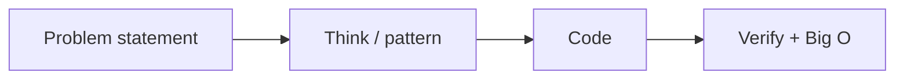
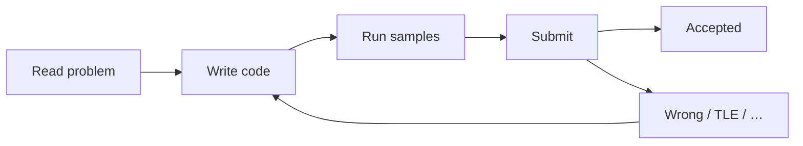

# 🌍 01 · Welcome To The World

> 📌 **At a glance**
>
> **For:** absolute beginners — problem solving **and** LeetCode.  
> **Goal:** know what this world is, why people train in it, and how an online judge works.

---

## What “problem solving” means here

In software interviews and coding practice, **problem solving** usually means:

> Given a **clear problem statement** + **constraints**, invent an **algorithm**, pick a **data structure**, implement it (often in code), and justify **correctness** + **time/space complexity**.

It is **not** the same as:

| This world | Not this (by itself) |
|:---|:---|
| Short, self-contained puzzles | Building a whole product feature |
| Focus on algorithms & structures | Only UI / only DevOps |
| Judged by correctness + efficiency | Judged only by “it runs on my machine” |



---

## Why companies care

Interviewers use these problems as a **compressed signal**:

| They watch for… | Why |
|:---|:---|
| Can you understand a spec? | Real tickets start as unclear text |
| Can you pick a structure? | Daily engineering judgment |
| Can you improve a slow idea? | Performance matters |
| Can you talk while thinking? | Team communication |
| Do you test edge cases? | Production bugs live on edges |

You are not memorizing “tricks for fun” — you are training a **thinking loop**.

In a **live** coding round, that loop is also what you **say** (clarify → brute → improve → test).  
Details: [02 · Live coding · 6 steps](./02-How-To-Practice.md#live-coding-interview--6-steps).

---

## Where people practice

| Arena | What it is |
|:---|:---|
| **Interview prep** | Timed problems, talk-through, whiteboard / shared editor |
| **Online judges** | Sites that run your code on hidden tests (LeetCode, etc.) |
| **Contests** | Competitive programming (harder / faster) — optional later |
| **This repo** | 49 high-ROI interview patterns + a full prep library |

You do **not** need contest experience to benefit from the 49.

---

## Skills you will grow

```text
  1. Read a problem carefully
  2. Spot a pattern (hash, window, tree, …)
  3. Start from brute force honestly
  4. Improve time / space
  5. Name complexity in Big O
  6. Hunt edge cases
  7. Explain your idea out loud
```

That loop is the same whether the company uses LeetCode-style rounds or a similar format.

---

## How this folder helps a total beginner

| Stage | What you do |
|:---|:---|
| **Now** | Learn the culture + vocabulary (this sheet → how to practice) |
| **Then** | Big O + edges → short C++ → pattern map → pattern sheets **in order** |
| **Then** | Pass the checklist → solve folders `01…49` (Brute → Optimized → Optimal) |
| **Later** | Reuse the same loop on new problems outside this repo |

---

## Mindset rules (keep forever)

1. **Stuck is normal** — the skill is recovering, not never struggling.  
2. **Brute force is allowed** — it proves you understand the statement.  
3. **Patterns > memorizing answers** — same ideas repeat.  
4. **Talk as you think** — interviews grade communication.  
5. **Consistency beats hero days** — one solid problem > ten half-reads.  

---

## 📘 Part B — LeetCode (the judge this repo uses)

### What LeetCode is

[LeetCode](https://leetcode.com/) is an **online practice platform**:

1. You open a **problem**  
2. You write code in the browser (or locally)  
3. You **Run** on sample tests  
4. You **Submit** → server runs **hidden tests**  
5. You get **Accepted** or a failure reason (Wrong Answer, TLE, …)



Other judges exist (HackerRank, Codeforces, …). The **habits** transfer. This repo’s links point at LeetCode because the Pareto set is defined there.

---

### Difficulty labels

| Label | Rough meaning |
|:---|:---|
| **Easy** | Usually one clear idea; good for learning a pattern |
| **Medium** | Combines ideas; most interview bulk |
| **Hard** | Heavier invariants / more moving parts |

The **49** mix Easy/Medium (and the patterns behind Hard interviews). Difficulty is a hint, not a personality test.

---

### Anatomy of a LeetCode problem page

When you open any checklist link, expect:

| Section | What to do with it |
|:---|:---|
| **Title + ID** | Name the problem in speech (“Two Sum”) |
| **Description** | The rules of the game |
| **Examples** | Input → output → explanation |
| **Constraints** | Size limits, value ranges, sorted?, unique? — **change the approach** |
| **Follow-up** | Often “can you do it in O(n)?” — matches Brute → Optimal |
| **Editor** | Language + `Solution` class stub |

```text
  ┌──────────────────────────────────────┐
  │  Description                         │
  │  Examples                            │
  │  Constraints   ← read carefully      │
  │  Follow-up                           │
  ├──────────────────────────────────────┤
  │  Code editor (C++ / …)               │
  │  [Run]  [Submit]                     │
  └──────────────────────────────────────┘
```

---

### Submit outcomes (common)

| Result | Meaning |
|:---|:---|
| **Accepted** | Passed hidden tests |
| **Wrong Answer** | Logic bug or missed edge |
| **Time Limit Exceeded (TLE)** | Too slow for constraints → need better Big O |
| **Runtime Error** | Crash / null / bad index |
| **Compile Error** | Syntax / types |

TLE on large `n` is your cue: the brute force was understood — now optimize (exactly this repo’s methodology).

---

### How this repo uses LeetCode

| LeetCode | This repo |
|:---|:---|
| Problem statement + tests | Links in the root checklist |
| Your practice submissions | Optional — great for verification |
| One “best” editorial | **Three** C++ stages (you) + **three** Mermaid flowcharts (Cursor AI) |

You can solve **offline** in the repo folders first, then paste into LeetCode to confirm.

---

### Account tips (beginner)

- Free account is enough for the 49  
- Save notes / star problems if you like  
- Don’t spiral into random Daily Challenge until the 49 patterns feel familiar  

---

### ✅ Self-check

- [ ] I can explain problem solving in one sentence  
- [ ] I know why interviews use these puzzles  
- [ ] I accept brute → better as a normal path  
- [ ] I know what Run vs Submit does  
- [ ] I always read **Constraints**  
- [ ] I know TLE usually means “need a better complexity”

➡️ **Next →** [02-How-To-Practice.md](./02-How-To-Practice.md)
