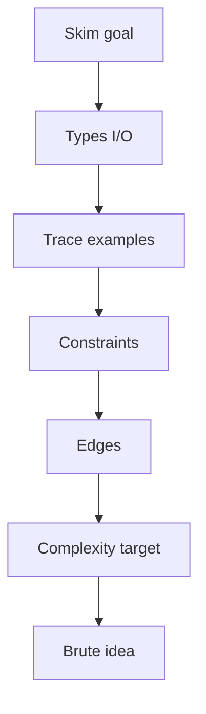
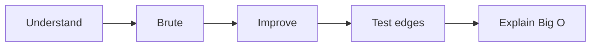

# 🧭 02 · How To Practice

> 📌 **At a glance**
>
> **For:** a repeatable way to **read** any problem and **solve** it (LeetCode, interview, or this repo).  
> **Goal:** never open a statement without a ritual, never code without a plan.

---

## 📗 Part A — How to read a problem

### The 6-pass read (use always)

| Pass | Focus | Output |
|:---:|:---|:---|
| **1** | One-sentence goal | “Return whether any value appears twice.” |
| **2** | Input / output types | `vector<int>` → `bool` |
| **3** | Examples by hand | Trace example 1 on paper |
| **4** | Constraints | `n` size, sorted?, duplicates?, ranges |
| **5** | Edge cases | Empty, single, all same, … |
| **6** | Follow-up / hints | Target complexity |



**Do not code before pass 4.** Constraints decide if O(n²) is even allowed.

---

### Translate English → CS objects

| Statement word | Often means |
|:---|:---|
| “array / list of integers” | `vector` / array |
| “indexed from 0” | Careful with loops |
| “return the indices” | Order may matter; 1-based vs 0-based |
| “you may assume” | Free facts — use them |
| “it is guaranteed” | No need to handle that error |
| “in-place” | Limit extra memory |
| “follow-up: O(1) space” | Harder version after brute |

---

### Worked micro-example (Contains Duplicate)

**Statement idea:** return true if any value appears ≥ 2 times.

| Pass | Notes |
|:---|:---|
| Goal | Detect duplicate existence |
| I/O | `nums` → `bool` |
| Example | `[1,2,3,1]` → true (hand-check) |
| Constraints | Often `n` up to 10⁵ → O(n²) may TLE |
| Edges | `[]` → false; `[7]` → false |
| Follow-up | Faster than nested loops → hash set |

Now you are ready for Brute → Optimal (playbook below).

---

### Red flags in constraints

| You see… | Think… |
|:---|:---|
| `n ≤ 10^5` or `10^6` | Aim O(n) / O(n log n), not O(n²) |
| `n ≤ 100` | O(n²) or O(n³) might be OK for brute learning |
| “array is sorted” | Two pointers / binary search candidates |
| “only lowercase letters” | Count array size 26 possible |
| “linked list” | Pointers, not random access |

---

### Interview vs LeetCode reading

| LeetCode | Live interview |
|:---|:---|
| Full text on screen | You may need to **clarify** with the interviewer |
| Hidden tests | You invent tests out loud |
| Instant Submit | You dry-run on examples verbally |

Same reading passes — plus **ask** if a constraint is missing.

---

### ✅ Self-check

- [ ] I have a fixed order: goal → I/O → examples → constraints → edges  
- [ ] I refuse to code before knowing rough `n`  
- [ ] I can restate any problem in one sentence

---

## 📘 Part B — Problem-solving playbook

### The universal loop



| Step | Do this |
|:---|:---|
| **Understand** | 6-pass read (above) |
| **Brute** | Correct naive idea — prove you get the statement |
| **Improve** | Faster / less memory using a pattern |
| **Test** | Happy path + edges |
| **Explain** | Time & space in Big O |

> ℹ️ **5-step loop** = how you **solve** (solo LeetCode / this repo).  
> **6-step live loop** (next section) = how you **speak** the same work in a whiteboard / shared-editor round. Same brain — different packaging.

---

### How **this repo** encodes the loop

Every problem folder:

| File | Who | Playbook step |
|:---|:---|:---|
| `1-Brute-Force.c++` | **You** | Honest slow-correct |
| `2-Optimized.c++` | **You** | Mid improvement |
| `3-Optimal.c++` | **You** | Best practical for interviews here |
| `1-…` / `2-…` / `3-….flowchart.md` | **Cursor AI** | Mermaid control-flow for **that** approach |

```text
  You code the three C++ files
       ↓
  Cursor AI draws three Mermaid flowcharts (one per approach)
       ↓
  Interview speech ≈ Brute → “better” → Optimal  (+ charts to explain each)
```

No draw.io / `.png`. Format = **Mermaid in Markdown** (renders on GitHub). Details: root `README.md`.

---

### Live coding interview · 6 steps

Whiteboard / shared-editor rounds score **process**, not only the final snippet.  
Use this order every time (same spirit as industry “clarify → brute → optimize → code → test” routines, including [Manara](https://support.manara.tech/knowledge/how-to-land-a-job-at-a-global-tech-company)’s coding-interview focus):

| # | Step | Say / do | Maps to this repo |
|:---:|:---|:---|:---|
| **1** | **Clarify** | Inputs, output, sizes, duplicates, in-place?, sorted? | 6-pass read (Part A) |
| **2** | **Examples** | One normal + one edge **by hand** | Edge list in [03](./03-Big-O-And-Edges.md) |
| **3** | **Brute** | Simplest correct idea + Big O — get agreement | `1-Brute-Force.c++` |
| **4** | **Optimize** | What repeated work can you remove? New Big O | `2-Optimized.c++` → `3-Optimal.c++` |
| **5** | **Code** | Small pieces; narrate; wait for “go” before typing if live | Your C++ files |
| **6** | **Test** | Trace example, edges, state time/space | Comments + mental Submit |

> ⚠️ **Don’t rush to code.** Leading the interview ≠ starting to type in the first minutes.  
> Clarifying questions and a spoken brute often earn more credit than silent Optimal.

**What interviewers usually watch for** (technical only — this repo’s scope):

| Signal | You show it by… |
|:---|:---|
| Spec literacy | Asking constraints; not assuming “all positive / non-empty” |
| Structure judgment | Naming hash / window / DFS *before* coding |
| Improvement | Brute first, then a better Big O |
| Communication | Thinking out loud; tradeoffs in one sentence |
| Correctness habits | Edges + complexity after the code |

Out of scope here: behavioral STAR stories, salary, resume — keep those in a separate interview-prep track if you use one.

---

### Pattern recognition (the shortcut)

After prep pattern sheets **06–15**, you will ask:

> “Have I seen this shape before?”

| Shape | First weapon |
|:---|:---|
| Need fast “seen before?” | Hash set/map |
| Sorted pair / ends | Two pointers |
| Contiguous best segment | Sliding window |
| Match / next greater | Stack |
| Sorted find | Binary search |
| Node chain | Linked list |
| Hierarchy | Tree DFS/BFS |
| Repeated max/min / top-K | Heap |
| Grid flood / prereqs | Graph |

Full map: [05-Pattern-Map-For-The-49.md](./05-Pattern-Map-For-The-49.md).

---

### When you are stuck (anywhere — not only the 49)

1. Re-trace an **example by hand**  
2. Write the **brute** even if ugly  
3. Ask: which **prep sheet** pattern fits?  
4. Shrink the problem (n=3) on paper  
5. Check **constraints** again  
6. Take a short break; return with only the invariant  

---

### Practice hygiene (general)

| Do | Don’t |
|:---|:---|
| Time-box a first attempt | Infinite scrolling of solutions in 30s |
| Compare after **your** brute exists | Copy Optimal first |
| Revise patterns weekly | Only grind random Hard |
| Speak aloud alone (mock the 6 steps) | Silent coding only (interviews need talk) |
| Occasional timed + peer mock if you can | Only untimed grinding forever |

---

### After the 49

The playbook stays the same:

```text
  New LeetCode / interview problem
       ↓
  Same reading ritual + brute → improve + Big O
       ↓
  You reuse patterns from this pack
```

This folder is your **home base**; the 49 are the first **campaign**.

---

### Self-check (playbook)

- [ ] I can list the 5 loop steps without looking  
- [ ] I can list the **6 live-interview steps** (clarify → … → test)  
- [ ] I know how Brute/Opt/Optimal map to interview talk  
- [ ] I have a stuck protocol  

➡️ **Next →** [03-Big-O-And-Edges.md](./03-Big-O-And-Edges.md)
