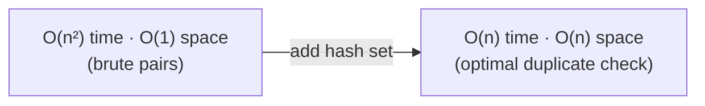
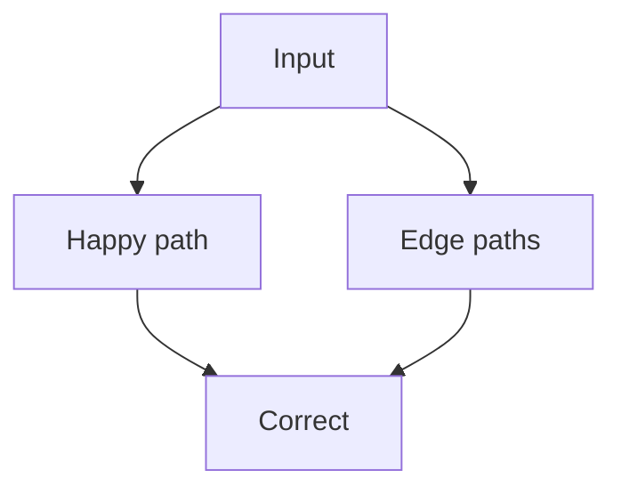

# 03 · Big O And Edges

**Goal:** read every Time/Space line in the 49, and never ship a “happy-path only” solution.

---

# Part A — Big O · Time · Space

## Definitions

| Term | Meaning |
|:---|:---|
| **Time complexity** | How the **number of steps** grows as input size grows |
| **Space complexity** | How much **extra memory** you allocate (beyond the given input) |
| **Big O** | Upper bound on **worst-case** growth — ignore constants and lower-order terms |

```text
  steps
    ▲
    │          ●  O(n²)
    │        ●
    │      ●     O(n log n)
    │    ●   ●
    │  ●       ●  O(n)
    │●___________● O(1)
    └──────────────▶ n (input size)
```

---

## Classes you will actually see in this repo

| Big O | Intuition | Where in the 49 |
|:---|:---|:---|
| **O(1)** | Constant work | Hash get/put (average), stack push/pop, heap peek |
| **O(log n)** | Halve the space each step | Binary search (#19–21) |
| **O(n)** | One (or few) linear passes | Hash scans, two pointers, windows, many DFS/BFS |
| **O(n log n)** | Sort or heap across n items | Some top-K / heap approaches (#40–42) |
| **O(n²)** | Nested loops over n | Typical **brute force** before optimizing |
| **O(n³)** | Triple nested | Naive 3Sum brute (#11) before two pointers |

For grids (#43–47): often **O(m·n)** cells.  
For graphs (#45, #48–49): often **O(V + E)**.

---

## Best / average / worst (hashing)

| | Meaning in this repo |
|:---|:---|
| **Average O(1)** | Hash set/map lookup — what we usually quote |
| **Worst O(n)** | Pathological hash collisions (rare in interviews; still know it exists) |

When a solution says “hash map O(1)”, it means **average**.

---

## What counts as “extra space”?

| Counts as extra space | Usually ignored |
|:---|:---|
| Hash set/map you allocate | The input array/list itself |
| Recursion call stack | Output array **if the problem requires returning it** (say so out loud) |
| Queue/stack for BFS/DFS | — |

---

## Time ↔ space trade-off



Classic in **#1 Contains Duplicate**.

---

## How to measure an idea (interview script)

1. What is `n`? (length, nodes, `V`/`E`, rows×cols)  
2. How many times do I touch each element?  
3. What extra structures grow with `n`?  
4. Say: **Time O(…) · Space O(…)**  

---

## Reading comments in this repo

```text
Time Complexity:  O(N)   ← linear in input size
Space Complexity: O(N)   ← extra structure proportional to N
```

Same letter `N` / `n` — convention only.

---

## Same ideas in C++ (short)

```cpp
// O(n) — one pass
for (int x : nums) { /* … */ }

// O(n²) — nested loops (typical brute force)
int n = (int)nums.size();
for (int i = 0; i < n; i++)
    for (int j = i + 1; j < n; j++)
        { /* compare nums[i] and nums[j] */ }
```

Other languages: same structure, different syntax.  
C++ track: [04-Cpp-For-The-49.md](./04-Cpp-For-The-49.md).

---

## Common mistakes

| Mistake | Fix |
|:---|:---|
| “Two nested loops are always O(n²)” | True if both run ~n; not if inner is log n |
| Ignoring recursion stack | Depth `h` ⇒ often O(h) space |
| Calling hash O(1) “always” | Say **average** O(1) |

---

## Self-check (Big O)

- [ ] I can explain O(1), O(log n), O(n), O(n log n), O(n²) with an example from the 49  
- [ ] I can separate **time** from **space**  
- [ ] I know why Optimal #1 may use more space than Brute

---

# Part B — Edge cases · interview mindset

## What is an edge case?

An input at the **boundary** of the problem rules — empty, tiny, extreme, weird — that still must produce a correct answer (or a defined empty result) without crashing.



---

## Universal checklist (run on every problem)

| # | Edge | Question |
|:---:|:---|:---|
| 1 | **Empty** | `n == 0`? empty string? null head/root? |
| 2 | **Single** | `n == 1`? one node? |
| 3 | **Two** | Smallest interesting size for pairs/windows |
| 4 | **All equal** | Duplicates everywhere |
| 5 | **All unique** | Opposite extreme |
| 6 | **Sorted / reverse sorted** | Order extremes |
| 7 | **Negatives / zero** | Signs, products, prices |
| 8 | **Duplicates allowed?** | Statement constraints |
| 9 | **Bounds** | First/last index, off-by-one |
| 10 | **Disconnected / null children** | Trees & graphs |
| 11 | **Cycle yes/no** | Lists & course graphs |
| 12 | **Max constraints** | Will O(n²) TLE? |

---

## Per-category edges (for the 49)

| Category | Extra edges to name |
|:---|:---|
| Arrays & Hashing | Empty; frequency 0; anagram length mismatch |
| Two Pointers | Already palindrome; no pair sums to target; all zeros heights |
| Sliding Window | `k = 0`; window never valid; full-string window |
| Stack | Empty string; only opens; never warmer day |
| Binary Search | Length 1; not rotated; target missing |
| Linked List | Empty; remove head; no cycle; capacity 1 (LRU) |
| Trees | Empty; skewed; BST vs non-BST shapes |
| Heap | `k = 1` or `k = n`; equal stones |
| Graphs | Empty grid; all water; no prerequisites; cycle in courses |

---

## Interview talking script (30–60s before code)

1. **Restate** input / output in one sentence  
2. **Constraints** that change the approach (sorted? unique? size?)  
3. **Two edge cases** you will handle  
4. **Brute** idea + Big O  
5. **Better** idea + Big O  
6. Then code  

This matches the repo: Brute → Optimized → Optimal.

---

## How solutions in this repo document edges

Look for comments like:

```text
Edge Cases Handled:
- Empty arrays …
- Single element …
```

You should be able to invent that list **before** reading the Optimal file.

---

## Self-check (edges)

- [ ] I can list ≥5 universal edges without looking  
- [ ] For a random category above, I can name 2 specific edges  
- [ ] I practice saying edges **before** coding

**C++ solvers:** study [04](./04-Cpp-For-The-49.md) carefully before pattern coding.  
**Other languages:** skim 04 once so C++ sketches in 06–15 are readable — then translate freely.

Next → [04-Cpp-For-The-49.md](./04-Cpp-For-The-49.md)
