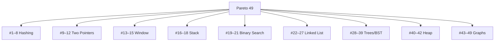

# 05 · Pattern Map For The 49

**Goal:** see every problem’s **home pattern** before you open its folder.

---

## Bird’s-eye



---

## Full map (all 49)

| # | Problem | Pattern sheet |
|:---:|:---|:---|
| 1 | Contains Duplicate | [06 Arrays & Hashing](./06-Arrays-Hashing.md) |
| 2 | Valid Anagram | 06 |
| 3 | Two Sum | 06 |
| 4 | Group Anagrams | 06 |
| 5 | Top K Frequent Elements | 06 (+ heap ideas in [14](./14-Heap-Priority-Queue.md)) |
| 6 | Valid Sudoku | 06 |
| 7 | Product of Array Except Self | 06 |
| 8 | Longest Consecutive Sequence | 06 |
| 9 | Valid Palindrome | [07 Two Pointers](./07-Two-Pointers.md) |
| 10 | Two Sum II (sorted) | 07 |
| 11 | 3Sum | 07 |
| 12 | Container With Most Water | 07 |
| 13 | Best Time to Buy and Sell Stock | [08 Sliding Window](./08-Sliding-Window.md) |
| 14 | Longest Substring Without Repeating Characters | 08 |
| 15 | Longest Repeating Character Replacement | 08 |
| 16 | Valid Parentheses | [09 Stack](./09-Stack.md) |
| 17 | Min Stack | 09 |
| 18 | Daily Temperatures | 09 |
| 19 | Binary Search | [10 Binary Search](./10-Binary-Search.md) |
| 20 | Find Minimum in Rotated Sorted Array | 10 |
| 21 | Search in Rotated Sorted Array | 10 |
| 22 | Reverse Linked List | [11 Linked List](./11-Linked-List.md) |
| 23 | Merge Two Sorted Lists | 11 |
| 24 | Reorder List | 11 |
| 25 | Remove Nth Node From End of List | 11 |
| 26 | Linked List Cycle | 11 |
| 27 | LRU Cache | 11 |
| 28 | Invert Binary Tree | [13 Trees / BST](./13-Trees-BST.md) |
| 29 | Maximum Depth of Binary Tree | 13 |
| 30 | Diameter of Binary Tree | 13 |
| 31 | Balanced Binary Tree | 13 |
| 32 | Same Tree | 13 |
| 33 | Subtree of Another Tree | 13 |
| 34 | Lowest Common Ancestor of a BST | 13 |
| 35 | Binary Tree Level Order Traversal | 13 + [12](./12-Traversal-Recursion-Queue.md) |
| 36 | Binary Tree Right Side View | 13 + 12 |
| 37 | Count Good Nodes in Binary Tree | 13 |
| 38 | Validate Binary Search Tree | 13 |
| 39 | Kth Smallest Element in a BST | 13 |
| 40 | Kth Largest Element in a Stream | [14 Heap](./14-Heap-Priority-Queue.md) |
| 41 | Last Stone Weight | 14 |
| 42 | Kth Largest Element in an Array | 14 |
| 43 | Number of Islands | [15 Graphs](./15-Graphs.md) |
| 44 | Max Area of Island | 15 |
| 45 | Clone Graph | 15 |
| 46 | Pacific Atlantic Water Flow | 15 |
| 47 | Surrounded Regions | 15 |
| 48 | Course Schedule | 15 |
| 49 | Course Schedule II | 15 |

---

## “First weapon” chooser

```text
 Need fast "seen before?" / counts?  → Hash set/map     (#1–8)
 Pair from ends / sorted pair?       → Two pointers     (#9–12)
 Best contiguous segment?            → Sliding window   (#13–15)
 Match brackets / next greater?      → Stack            (#16–18)
 Find in sorted / rotated?           → Binary search    (#19–21)
 Node.next chains?                   → Linked list      (#22–27)
 Hierarchy / BST rules?              → Tree DFS/BFS     (#28–39)
 Repeated max/min / top-K?           → Heap             (#40–42)
 Grid flood / prerequisites?         → Graph DFS/BFS    (#43–49)
```

---

## How to use this map

**While studying prep:** after this sheet, walk **06 → 16** with `Next →` (do **12 Traversal before 13 Trees / 15 Graphs**).

**While solving the 49 later:**

1. Pick the next unsolved `#` from the root checklist  
2. Open the sheet in the right column  
3. Skim that sheet’s problem-by-problem section  
4. Then open the problem folder and solve  

If you are brand new to LeetCode, finish **[01–02](./01-Welcome-To-The-World.md)** first.

Next → [06-Arrays-Hashing.md](./06-Arrays-Hashing.md)
