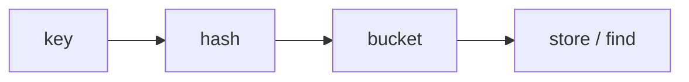

# 06 · Arrays & Hashing

**Problems:** **#1–8** · **Status:** complete reference for this block

---

## Core ideas

| Structure | What it gives you |
|:---|:---|
| **Array / `vector`** | Index access O(1); scan O(n) |
| **Hash set** | “Have I seen this?” average O(1) |
| **Hash map** | key → value / count / index, average O(1) |

```text
 values:  [1, 2, 1]
 index:    0  1  2

 set while scanning:
   {} → {1} → {1,2} → 1 already in set → duplicate
```



---

## Operations you must know

| Op | Array | Hash set/map (avg) |
|:---|:---|:---|
| Access by index | O(1) | — |
| Scan all | O(n) | O(n) to iterate |
| Search value | O(n) | **O(1)** |
| Insert | O(1) amortized at end | **O(1)** |

---

## Problem-by-problem (what to know before coding)

| # | Problem | You must understand |
|:---:|:---|:---|
| **1** | Contains Duplicate | Set membership; trade O(n) space for O(n) time |
| **2** | Valid Anagram | Same char counts (map or count[26]) |
| **3** | Two Sum | Map `value → index` while scanning |
| **4** | Group Anagrams | Key = sorted word or count signature → list |
| **5** | Top K Frequent | Count map, then bucket sort **or** heap ([14](./14-Heap-Priority-Queue.md)) |
| **6** | Valid Sudoku | Track seen digits per row, col, box |
| **7** | Product Except Self | Prefix/suffix products; no division |
| **8** | Longest Consecutive Sequence | Set; start only at run beginnings → O(n) |

---

## Patterns inside this block

### A · Detect / count with a set or map
Used in #1, #2, #3, #6.

### B · Group by a canonical key
Used in #4 (anagram key).

### C · Frequency then select top-K
Used in #5.

### D · Prefix / suffix accumulation
Used in #7:

```text
 nums:     a  b  c  d
 prefix:   1  a  ab abc
 suffix:   bcd cd  d  1
 answer[i] = prefix[i] * suffix[i]
```

### E · Hash set for O(1) “exists” in sequences
Used in #8 — only expand a streak from numbers that have `x-1` **missing**.

---

## Complexity targets (after Optimal)

| # | Typical Optimal time | Typical extra space |
|:---:|:---|:---|
| 1–4, 6, 8 | O(n) | O(n) |
| 5 | O(n) with buckets | O(n) |
| 7 | O(n) | O(1) extra if output excluded / or O(n) for answers |

---

## Edge cases for #1–8

- Empty / one element  
- No duplicates vs all duplicates  
- Anagrams different lengths → false  
- Sudoku `'.'` empty cells  
- Zeros / negatives in products (#7)  
- Single-number consecutive streak (#8)  

---

## C++ mini-example (idea of #1)

```cpp
#include <vector>
#include <unordered_set>
using namespace std;

bool containsDuplicate(vector<int>& nums) {
    unordered_set<int> seen;
    for (int x : nums) {
        if (seen.count(x)) return true;
        seen.insert(x);
    }
    return false;
}
```

**Not C++?** Same algorithm with a set + one loop — translate freely.  
C++ track: [04](./04-Cpp-For-The-49.md).

---

## Self-check

- [ ] I can explain set vs map  
- [ ] I can sketch Two Sum with a map on paper  
- [ ] I know why #7 needs prefix/suffix

Next → [07-Two-Pointers.md](./07-Two-Pointers.md)
