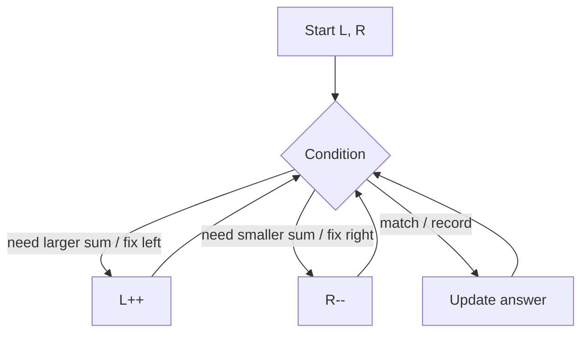

# 👆 07 · Two Pointers

> 📌 **At a glance**
>
> **Problems:** **#9–12** · **Status:** complete reference for this block

---

## 💡 Core idea

Use **two indices** that move through a structure so you avoid many nested loops.

```text
  L -------------------- R
  move based on a rule (sum too small? palindrome mismatch? height shorter?)
```



---

## When it fits (in the 49)

| Signal | Example |
|:---|:---|
| Array **sorted** | Two Sum II (#10), part of 3Sum (#11) |
| Compare from **both ends** | Palindrome (#9), container (#12) |
| After sorting, find pairs/triples | 3Sum (#11) |

---

## 📋 Problem-by-problem

| # | Problem | Pointer rule |
|:---:|:---|:---|
| **9** | Valid Palindrome | Skip non-alnum; compare `lower(L)` vs `lower(R)`; move inward |
| **10** | Two Sum II | Sorted; if sum < target `L++`; if sum > target `R--` |
| **11** | 3Sum | Sort; fix `i`; two pointers on `i+1…n-1`; skip duplicates |
| **12** | Container With Most Water | Area = `min(h[L],h[R]) * (R-L)`; move the **shorter** side |

---

## Visual: container (#12)

```text
  height
    8│   █         █
    7│   █         █
    6│   █   █     █
    5│   █   █     █
       └──L─────R──
  width = R - L
  limiting height = min(left bar, right bar)
```

---

## ⏱️ Complexity

| Approach | #9–10 | #11 | #12 |
|:---|:---|:---|:---|
| Brute | O(n²) pairs | O(n³) | O(n²) |
| Two pointers | **O(n)** | **O(n²)** after sort | **O(n)** |

Space usually **O(1)** extra (plus output / sort may be O(n)).

---

## 🧪 Edge cases

- Empty / length 1 (#9 → true)  
- No pair sums to target (#10)  
- Many duplicates (#11)  
- Height 0 bars (#12)  

---

## 💻 C++ mini-example (idea of #10)

```cpp
// a is sorted; return 1-based indices if that is what the problem asks
vector<int> twoSumSorted(vector<int>& a, int target) {
    int L = 0, R = (int)a.size() - 1;
    while (L < R) {
        int sum = a[L] + a[R];
        if (sum == target) return {L + 1, R + 1};
        if (sum < target) L++;
        else R--;
    }
    return {};
}
```

**Not C++?** Keep two indices; same move rules. See [04](./04-Cpp-For-The-49.md).

---

## ✅ Self-check

- [ ] I know why sorted enables Two Sum II in O(n)  
- [ ] I can explain why we move the shorter line in #12  
- [ ] I know to skip duplicates in 3Sum

➡️ **Next →** [08-Sliding-Window.md](./08-Sliding-Window.md)
