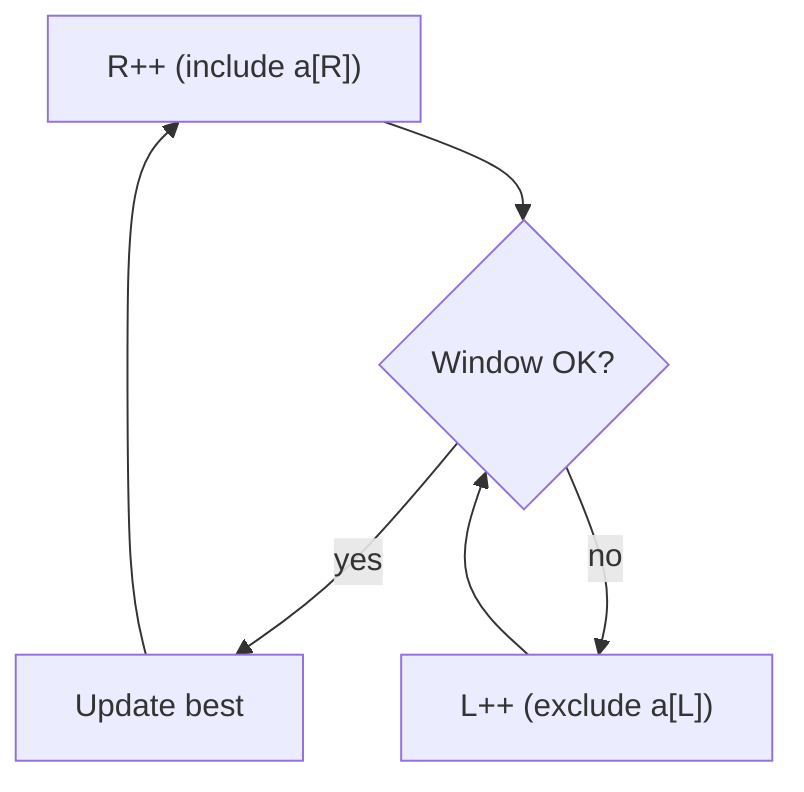

# 🪟 08 · Sliding Window


### ✅ My progress · this sheet

- [ ] I **read** this sheet end-to-end
- [ ] I can **explain** the main ideas without looking

> When both are checked → also tick this sheet in [PROGRESS.md](../PROGRESS.md#prep-sheets--your-reading-progress) and refresh the bars.

---
> 📌 **At a glance**
>
> **Problems:** **#13–15** · **Status:** complete reference for this block

---

## 💡 Core idea

**What it is:** A **contiguous** segment `[L, R]` you grow/shrink while keeping a rule true (unique chars, at most `k` changes, …).

**Remember:** Both pointers only move forward → usually **O(n)**. Think “best / longest / shortest **contiguous** piece,” not arbitrary subsequences.

```text
  [ a b c a b c b b ]
      L-----R
  expand R → → →
  if invalid: L → → until valid again
```



Often need a **count map** / last-seen index for what is inside the window.

---

## 📋 Problem-by-problem

| # | Problem | Window / state |
|:---:|:---|:---|
| **13** | Best Time to Buy and Sell Stock | Running **min price** so far; max `price - min` (specialized one-pass window) |
| **14** | Longest Substring Without Repeating | Window of unique chars; shrink when duplicate enters |
| **15** | Longest Repeating Character Replacement | Window valid while `windowLen - maxFreq <= k` |

---

## Visual: #14 unique window

```text
  s = a b c a
      L     R     map: a,b,c
  next a duplicates → move L past old a
      L=1   R=3   window b c a  length 3
```

---

## ⏱️ Complexity

Both `L` and `R` only move forward ⇒ **O(n)** time.  
Space **O(Σ)** (alphabet / distinct chars in window).

---

## 🧪 Edge cases

- Empty string  
- All unique / all same  
- `k = 0` (#15)  
- Single char  

---

## 💻 C++ mini-example (idea of #14)

```cpp
#include <string>
#include <unordered_set>
using namespace std;

int lengthOfLongestSubstring(string s) {
    unordered_set<char> seen;
    int L = 0, best = 0;
    for (int R = 0; R < (int)s.size(); R++) {
        while (seen.count(s[R])) {
            seen.erase(s[L]);
            L++;
        }
        seen.insert(s[R]);
        best = max(best, R - L + 1);
    }
    return best;
}
```

**Not C++?** Same L/R + set; translate. See [04](./04-Cpp-For-The-49.md).

---

## ✅ Self-check

- [ ] I can draw L/R expanding and shrinking  
- [ ] I can state the validity rule for #15  
- [ ] I know #13 is “min so far” not a classic two-bound window

➡️ **Next →** [09-Stack.md](./09-Stack.md)
