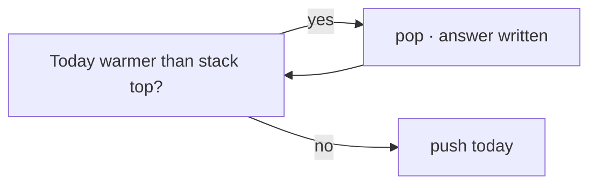

# 📚 09 · Stack

> 📌 **At a glance**
>
> **Problems:** **#16–18** · **Status:** complete reference for this block

---

## 💡 Core idea · LIFO

**What it is:** Last-In, First-Out — you only push/pop at the **top** (like a stack of plates).

**Remember:** Use it when the answer depends on the **most recent unmatched** item (brackets, nesting). **Monotonic** stack = keep order so “next greater” is O(n).

```text
  push → top
           ┌───┐
           │ 3 │ top
           │ 2 │
           │ 1 │
           └───┘
  pop  ← top
```

| Op | Time |
|:---|:---|
| push / pop / top | O(1) |

---

## 📋 Problem-by-problem

| # | Problem | Stack usage |
|:---:|:---|:---|
| **16** | Valid Parentheses | Push opens; on close, top must match; stack empty at end |
| **17** | Min Stack | Support getMin in O(1) — often second stack of minima |
| **18** | Daily Temperatures | **Monotonic** decreasing stack of indices → days until warmer |

---

## Visual: parentheses (#16)

```text
  ( [ ] )
  push (   push [   pop matches [   pop matches (
  stack empty → valid
```

## Visual: monotonic stack (#18)

```text
  temps: 73 74 75 71 69 72 76 73
  while stack top is colder than today → pop and set wait days
  push today’s index
```



---

## Min stack idea (#17)

```text
  values:  5  3  7
  mins:    5  3  3   ← parallel stack of current minimum
```

---

## ⏱️ Complexity

Each index pushed/popped ≤ once ⇒ **O(n)** for #16/#18.  
#17 ops **O(1)** time each if designed well. Space O(n).

---

## 🧪 Edge cases

- Empty string (#16 → true)  
- Only closers first  
- Single temperature (#18 → `[0]`)  
- Strictly decreasing temps (all zeros)  

---

## 💻 C++ mini-example (idea of #16)

```cpp
#include <stack>
#include <string>
using namespace std;

bool isValid(string s) {
    stack<char> st;
    for (char c : s) {
        if (c == '(' || c == '[' || c == '{') st.push(c);
        else {
            if (st.empty()) return false;
            char o = st.top(); st.pop();
            if ((c == ')' && o != '(') ||
                (c == ']' && o != '[') ||
                (c == '}' && o != '{')) return false;
        }
    }
    return st.empty();
}
```

**Not C++?** Same LIFO rules with your language’s stack. See [04](./04-Cpp-For-The-49.md).

---

## ✅ Self-check

- [ ] I can simulate #16 on `(]` and `()[]`  
- [ ] I know why a second stack helps getMin  
- [ ] I can explain “next warmer” with a monotonic stack

➡️ **Next →** [10-Binary-Search.md](./10-Binary-Search.md)
