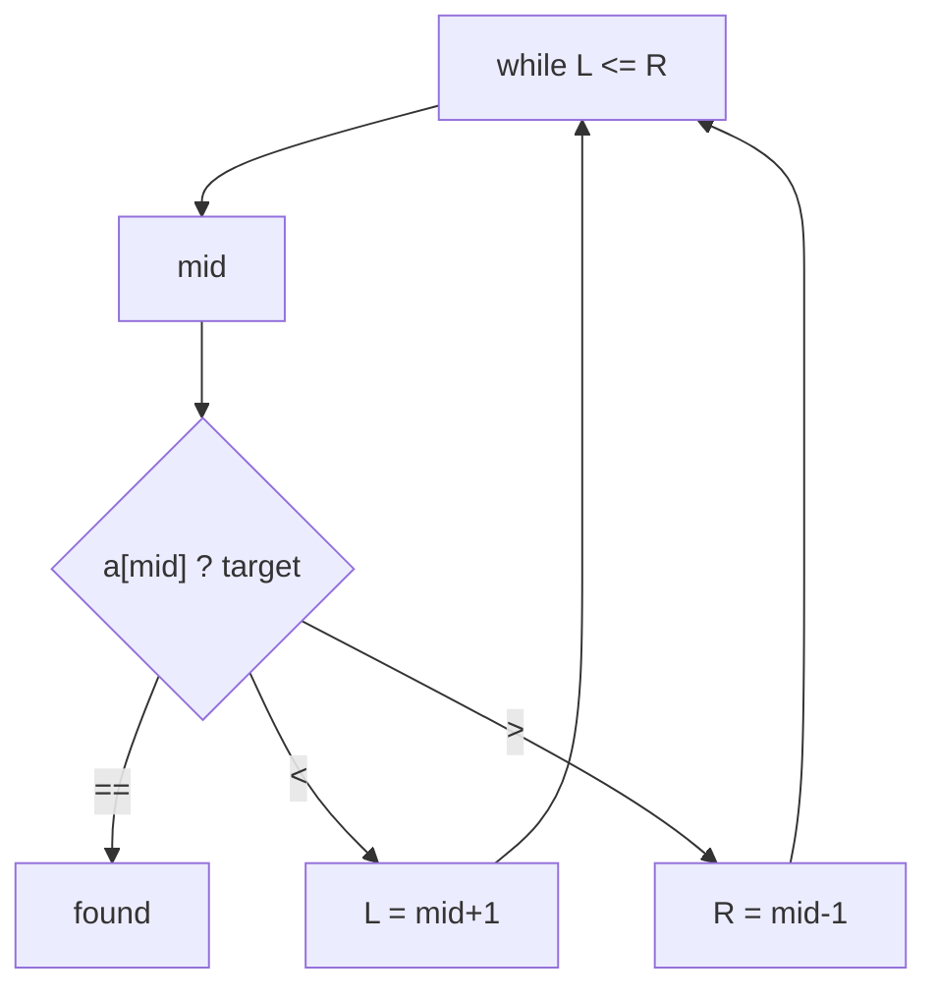

# 🎯 10 · Binary Search


### ✅ My progress · this sheet

- [ ] I **read** this sheet end-to-end
- [ ] I can **explain** the main ideas without looking

> When both are checked → also tick this sheet in [PROGRESS.md](../PROGRESS.md#prep-sheets--your-reading-progress) and refresh the bars.

---
> 📌 **At a glance**
>
> **Problems:** **#19–21** · **Status:** complete reference for this block

---

## 💡 Core idea

**What it is:** On a **sorted** (or monotonic) range, compare the middle and **throw away half** each step.

**Remember:** O(log n). Needs order. Use `mid = L + (R - L) / 2`. Rotated arrays still work if you identify which half is sorted.

```text
  L           mid           R
  [············|············]
               ▲
         a[mid] ? target
```



**Time O(log n) · Space O(1)** (iterative).

---

## Rotated sorted array (needed for #20–21)

```text
  Sorted:   1 2 3 4 5 6 7
  Rotated:  4 5 6 7 1 2 3
            └─sorted─┘ └sorted┘
```

At `mid`, **at least one half is sorted**. Use that to decide where min / target lives.

---

## 📋 Problem-by-problem

| # | Problem | What to know |
|:---:|:---|:---|
| **19** | Binary Search | Classic mid loop; careful `L+R` overflow → `L + (R-L)/2` |
| **20** | Find Minimum in Rotated Sorted Array | If `a[mid] > a[R]` min is right; else min is mid or left |
| **21** | Search in Rotated Sorted Array | Decide which half is sorted; check if target in that half |

---

## Template (classic)

```text
L = 0, R = n-1
while L <= R:
  mid = L + (R-L)/2
  if a[mid] == target: return mid
  if a[mid] < target: L = mid+1
  else: R = mid-1
return -1
```

---

## ⏱️ Complexity

Each step halves the search space ⇒ **O(log n)** time, **O(1)** extra space  
(same for the rotated variants in #20–21 when done carefully).

---

## 🧪 Edge cases

- `n == 1`  
- Not rotated  
- Target at index 0 or n-1  
- Target absent (#21)  
- (These Pareto problems typically assume **unique** elements — always read constraints)

---

## 💻 C++ mini-example (classic search)

```cpp
#include <vector>
using namespace std;

int search(vector<int>& a, int target) {
    int L = 0, R = (int)a.size() - 1;
    while (L <= R) {
        int mid = L + (R - L) / 2;   // avoid overflow
        if (a[mid] == target) return mid;
        if (a[mid] < target) L = mid + 1;
        else R = mid - 1;
    }
    return -1;
}
```

**Not C++?** Same `L`/`R`/`mid` logic in any language. See [04](./04-Cpp-For-The-49.md).

---

## ✅ Self-check

- [ ] I can hand-simulate binary search on 7 elements  
- [ ] I can draw a rotated array and mark the sorted half  
- [ ] I know why mid uses `L+(R-L)/2`

➡️ **Next →** [11-Linked-List.md](./11-Linked-List.md)
