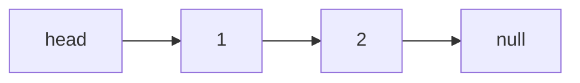
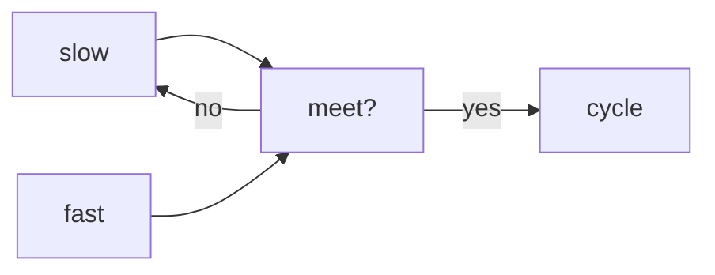

# 🔗 11 · Linked List


### ✅ My progress · this sheet

- [ ] I **read** this sheet end-to-end
- [ ] I can **explain** the main ideas without looking

> When both are checked → also tick this sheet in [PROGRESS.md](../PROGRESS.md#prep-sheets--your-reading-progress) and refresh the bars.

---
> 📌 **At a glance**
>
> **Problems:** **#22–27** · **Status:** complete reference for this block

---

## 💡 Core idea

**What it is:** Nodes chained by pointers (`next`; optional `prev` for doubly linked / LRU). No O(1) index access like an array.

**Remember:** Everything is a **walk + rewire**. Draw 3 nodes on paper before coding reverse/merge. Fast/slow = mid or cycle.

```text
  head → [1|*] → [2|*] → [3|/]
```



| Op (singly) | Typical cost |
|:---|:---|
| Walk all | O(n) |
| Insert/delete at known node | O(1) pointer rewires |
| Access by index | O(n) |

---

## Techniques used in #22–27

### Reverse pointers (#22)

```text
  prev=null  curr=head
  while curr:
    next = curr.next
    curr.next = prev
    prev = curr
    curr = next
  head = prev
```

### Merge two sorted lists (#23)

Always attach the smaller head; advance that list.

### Mid + reverse + merge (#24 Reorder)

1. Slow/fast → middle  
2. Reverse second half  
3. Interleave nodes  

### Gap of n (#25)

```text
  fast is n steps ahead of slow
  when fast hits end, slow is at node before removal target
```

### Fast / slow cycle (#26)

```text
  slow 1 step, fast 2 steps
  meet ⇒ cycle
```



### LRU Cache (#27)

**Hash map** key→node + **doubly linked list** for recency order.  
`get`/`put` move node to front; evict tail when over capacity. Target **O(1)**.

---

## 📋 Problem-by-problem

| # | Problem | Key idea |
|:---:|:---|:---|
| 22 | Reverse Linked List | Rewire `next` |
| 23 | Merge Two Sorted Lists | Two-list walk |
| 24 | Reorder List | Mid + reverse + merge |
| 25 | Remove Nth From End | Two pointers gap n |
| 26 | Linked List Cycle | Floyd fast/slow |
| 27 | LRU Cache | Map + DLL |

---

## ⏱️ Complexity

| Technique | Time | Extra space |
|:---|:---|:---|
| Reverse / merge / reorder walk | O(n) | O(1) |
| Remove nth / cycle detect | O(n) | O(1) |
| LRU get/put | O(1) amortized | O(capacity) |

---

## 🧪 Edge cases

- Empty / one node  
- Remove head (#25)  
- No cycle  
- Capacity 1 (#27)  
- get missing key  

---

## 💻 C++ mini-example (idea of #22)

```cpp
struct ListNode {
    int val;
    ListNode* next;
    ListNode(int x) : val(x), next(nullptr) {}
};

ListNode* reverseList(ListNode* head) {
    ListNode* prev = nullptr;
    ListNode* cur = head;
    while (cur) {
        ListNode* nxt = cur->next;
        cur->next = prev;
        prev = cur;
        cur = nxt;
    }
    return prev;
}
```

**Not C++?** Pointers ↔ references/links in your language. See [04](./04-Cpp-For-The-49.md).

---

## ✅ Self-check

- [ ] I can reverse a 3-node list on paper  
- [ ] I can explain why fast/slow finds a cycle  
- [ ] I know LRU needs both map and list for O(1)

➡️ **Next →** [12-Traversal-Recursion-Queue.md](./12-Traversal-Recursion-Queue.md)
