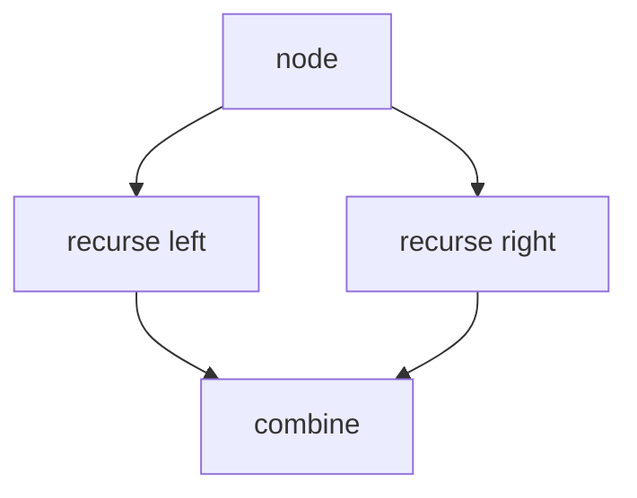
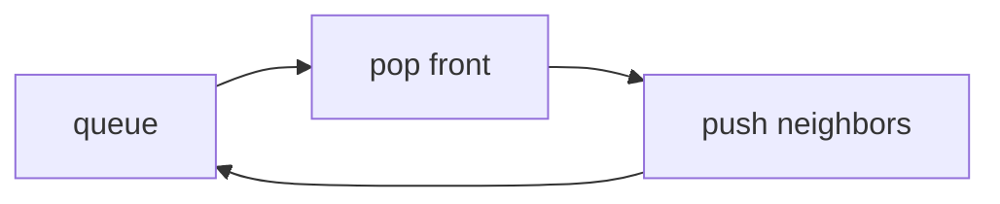

# 12 · Traversal · Recursion · Queue

**Shared engine** for **Trees (#28–39)** and **Graphs (#43–49)**.  
**Place in the path:** learn this **before** sheets 13 and 15 so recursion / DFS / BFS feel natural there.  
**Status:** complete reference for traversals used in the 49.

---

## Recursion

A function solves a big problem by calling itself on a **smaller** piece, plus a **base case** that stops.

```text
  depth(null)  = 0                 ← base
  depth(node)  = 1 + max(depth(L), depth(R))
```

```cpp
int depth(TreeNode* node) {
    if (node == nullptr) return 0;
    return 1 + max(depth(node->left), depth(node->right));
}
```



**Call stack** uses memory → often O(height) space.

---

## DFS (Depth-First Search)

Go as deep as possible, then backtrack.  
Implemented with **recursion** or an explicit **stack**.

Used for: invert tree, diameters, island flood, clone graph, course cycle DFS, good nodes, …

```text
  visit(node):
    mark visited
    for each neighbor / child:
      if not visited: visit(neighbor)
```

---

## BFS (Breadth-First Search)

Visit level by level using a **queue** (FIFO).

```text
  queue ← start
  while queue not empty:
    u ← pop front
    push fresh neighbors
```

Used for: tree level order (#35), right side view (#36), Kahn topo (#49), some floods.



```cpp
#include <queue>
#include <vector>
using namespace std;

// Level-order sketch (#35 idea)
vector<vector<int>> levelOrder(TreeNode* root) {
    vector<vector<int>> ans;
    if (!root) return ans;
    queue<TreeNode*> q;
    q.push(root);
    while (!q.empty()) {
        int sz = q.size();
        vector<int> level;
        for (int i = 0; i < sz; i++) {
            TreeNode* u = q.front(); q.pop();
            level.push_back(u->val);
            if (u->left) q.push(u->left);
            if (u->right) q.push(u->right);
        }
        ans.push_back(level);
    }
    return ans;
}
```

**Not C++?** Same queue + “process current level size” idea.

---

## DFS vs BFS picker (for the 49)

| Need | Prefer |
|:---|:---|
| Tree depth / diameter / BST validate | DFS recursion |
| Level order / right side | **BFS** |
| Island flood either works | DFS or BFS |
| Topological order (Kahn) | **BFS + indegree** |
| Cycle detect | DFS colors **or** Kahn |

---

## Visited marks

| Structure | How |
|:---|:---|
| Grid | Flip cell / `visited[r][c]` |
| Graph nodes | `unordered_set` or color array |
| Tree | Usually no set — tree has no cycles upward |

---

## Self-check

- [ ] I can write depth recursion in English  
- [ ] I can simulate BFS on a 3-level tree  
- [ ] I know why grids need visited marks

Next → [13-Trees-BST.md](./13-Trees-BST.md)
