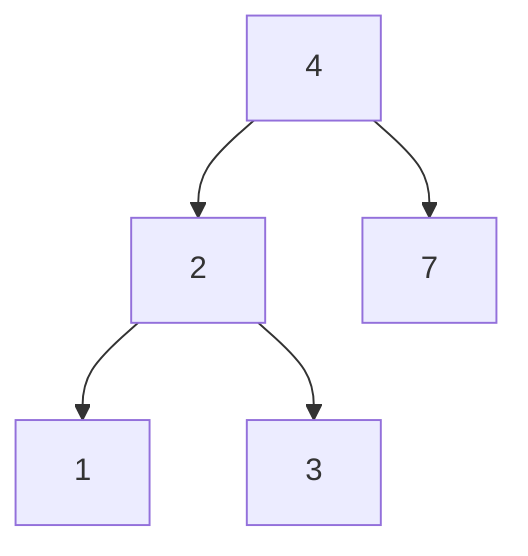

# 13 · Trees · BST

**Problems:** **#28–39** · **Status:** complete reference for this block  
**Requires:** [12 · Traversal](./12-Traversal-Recursion-Queue.md) (DFS / BFS) — finish it first.

---

## Core idea

```text
        4
       / \
      2   7
     / \
    1   3
```

Each node: `val`, `left`, `right` (nullable).

| Term | Meaning |
|:---|:---|
| **Root** | Top node |
| **Leaf** | No children |
| **Height / depth** | Levels from root or longest path (definitions vary — be consistent in code) |
| **BST** | For every node: left subtree values **<** node **<** right subtree values |

---

## Traversals you need

| Traversal | Order | Used for |
|:---|:---|:---|
| **DFS preorder** | node → left → right | Invert, compare shapes |
| **DFS inorder** | left → node → right | BST sorted order (#38–39) |
| **DFS postorder** | left → right → node | Heights / diameter bottoms-up |
| **BFS** | level by level (queue) | #35 level order, #36 right side |



---

## Problem-by-problem

| # | Problem | Must know |
|:---:|:---|:---|
| 28 | Invert Binary Tree | Swap left/right recursively |
| 29 | Maximum Depth | 1 + max(left, right); empty = 0 |
| 30 | Diameter | Longest path via depths of children |
| 31 | Balanced Binary Tree | Height diff ≤ 1 everywhere |
| 32 | Same Tree | Structure + values equal |
| 33 | Subtree of Another Tree | Same-tree check at candidates |
| 34 | LCA of a BST | Use BST order to walk |
| 35 | Level Order | BFS queue |
| 36 | Right Side View | BFS; last node per level |
| 37 | Count Good Nodes | DFS with running max on path |
| 38 | Validate BST | Inorder increasing **or** valid min/max ranges |
| 39 | Kth Smallest in BST | Inorder until k |

---

## BST extras

```text
  Search / LCA walk:
  if target < node → go left
  if target > node → go right
```

Inorder of a BST = sorted values → kth smallest is the k-th visit.

---

## Complexity

Visit each node once ⇒ **O(n)** time.  
Recursion / queue ⇒ **O(h)** or **O(n)** space (`h` = height; skewed ⇒ n).

---

## Edge cases

- Empty tree  
- Single node  
- Skewed (linked-list shape)  
- Not a BST when validating  

---

## C++ mini-example (idea of #29)

```cpp
struct TreeNode {
    int val;
    TreeNode* left;
    TreeNode* right;
};

int maxDepth(TreeNode* root) {
    if (!root) return 0;
    return 1 + max(maxDepth(root->left), maxDepth(root->right));
}
```

Level-order / BFS: see [12](./12-Traversal-Recursion-Queue.md).  
**Not C++?** Same recursion shape; translate the node type.

---

## Self-check

- [ ] I can write depth recursion in one line of English  
- [ ] I know inorder = sorted for BST  
- [ ] I know when to pick BFS vs DFS in this list

Next → [14-Heap-Priority-Queue.md](./14-Heap-Priority-Queue.md)
