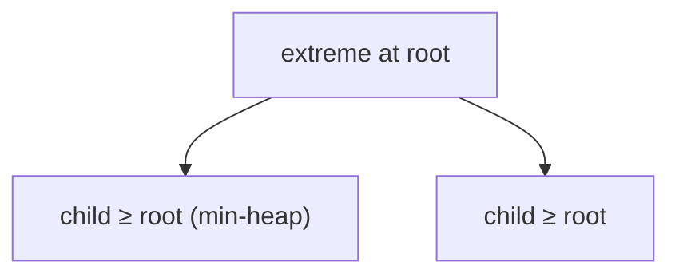

# 14 · Heap · Priority Queue

**Problems:** **#40–42** (also helps **#5** Top K) · **Status:** complete reference for this block

---

## Core idea

A **binary heap** keeps the **min** or **max** at the root.

```text
  Min-heap:
        1
       / \
      3   2
     /
    7
  peek min = 1 in O(1)
  push/pop fix heap in O(log n)
```



In C++: `priority_queue` (default **max-heap**).  
Min-heap: `priority_queue<int, vector<int>, greater<int>>`.

---

## Why “min-heap of size k” = kth largest

```text
  Keep only k largest values seen
  The smallest among them (heap root) is the kth largest overall
  If size > k → pop the smallest
```

---

## Problem-by-problem

| # | Problem | Heap plan |
|:---:|:---|:---|
| **40** | Kth Largest in a Stream | Min-heap size k across adds |
| **41** | Last Stone Weight | Max-heap; pop two heaviest; push difference if > 0 |
| **42** | Kth Largest in an Array | Min-heap size k **or** max-heap / sort |

---

## Complexity

| Op | Time |
|:---|:---|
| peek | O(1) |
| push / pop | O(log n) |
| Process n with heap size k | O(n log k) |

---

## Edge cases

- `k == 1` / `k == n`  
- All equal  
- Stream shorter than k (read #40 carefully)  
- Two equal stones → push nothing (#41)  

---

## C++ mini-example (kth largest · min-heap size k)

```cpp
#include <queue>
#include <vector>
using namespace std;

int findKthLargest(vector<int>& nums, int k) {
    // smallest on top → keep only k largest
    priority_queue<int, vector<int>, greater<int>> minH;
    for (int x : nums) {
        minH.push(x);
        if ((int)minH.size() > k) minH.pop();
    }
    return minH.top();
}
```

Default `priority_queue<int>` is a **max-heap**. See [04](./04-Cpp-For-The-49.md).  
**Not C++?** Same “heap of size k” idea with your language’s heap.

---

## Self-check

- [ ] I can explain min-heap of size k for kth largest  
- [ ] I know C++ `priority_queue` is max-heap by default  
- [ ] I can simulate #41 for `[2,7,4,1,8,1]` mentally

Next → [15-Graphs.md](./15-Graphs.md)
