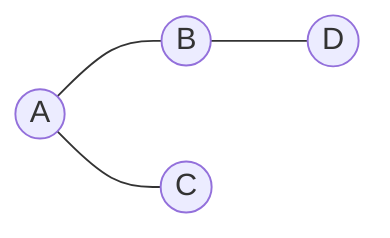

# 🌐 15 · Graphs


### ✅ My progress · this sheet

- [ ] I **read** this sheet end-to-end
- [ ] I can **explain** the main ideas without looking

> When both are checked → also tick this sheet in [PROGRESS.md](../PROGRESS.md#prep-sheets--your-reading-progress) and refresh the bars.

---
> 📌 **At a glance**
>
> **Problems:** **#43–49** · **Status:** complete reference for this block  
> **Requires:** [12 · Traversal](./12-Traversal-Recursion-Queue.md) (DFS / BFS) — you already passed it if you follow `Next →`.

---

## 💡 Core idea

**What it is:** **Vertices (nodes)** connected by **edges**. In the 49: either a **grid** of cells or an **adjacency list**.

**Remember:** Always mark **visited** (or flip the cell) or you loop forever. Traversal engine = sheet [12](./12-Traversal-Recursion-Queue.md) (DFS/BFS). Cycle in courses ⇒ cannot finish.

| Representation | Use in the 49 |
|:---|:---|
| **Grid** `char[][]` / `int[][]` | Islands, water flow, surrounded (#43–44, #46–47) |
| **Adjacency list** | Clone graph, courses (#45, #48–49) |

```text
  Grid:                 Adj list:
  1 1 0                 0: 1,2
  1 0 1                 1: 0
  0 0 1                 2: 0
```



Neighbors on a grid: **up / down / left / right** (4-directional in these problems).

---

## Flood fill · islands family

Mark visited land while DFS/BFS spreads.

| # | Problem | Idea |
|:---:|:---|:---|
| 43 | Number of Islands | Count components of `'1'` |
| 44 | Max Area of Island | Same + size |
| 46 | Pacific Atlantic | Multi-source flow from both oceans; intersect reachable sets |
| 47 | Surrounded Regions | Border-safe `'O'` survive; flip the rest |

```text
  Start DFS/BFS on a land cell
  visit all connected land
  that is one island
```

---

## Clone graph (#45)

DFS or BFS copy: map `old node → new node` so neighbors link to clones, not originals.

---

## Courses · directed graph (#48–49)

Edge `a → b` = “a is a prerequisite of b” (or the reverse — **read the problem statement**; build the graph accordingly).

| # | Problem | Idea |
|:---:|:---|:---|
| 48 | Course Schedule | Detect **cycle** (DFS colors or Kahn) |
| 49 | Course Schedule II | Emit **topological order** (Kahn indegrees or DFS) |


**Kahn sketch:** queue all indegree 0 → take course → reduce neighbors → if you process all nodes, order is valid.

---

## ⏱️ Complexity

| Setting | Time |
|:---|:---|
| Grid m×n | O(m·n) |
| Adj list | O(V + E) |

---

## 🧪 Edge cases

- Empty grid  
- All water / all land  
- Single node graph  
- Cycle in prerequisites  
- No edges (any order OK)  

---

## 💻 C++ mini-example (idea of #43 · flood fill)

```cpp
#include <vector>
using namespace std;

void dfs(vector<vector<char>>& g, int r, int c) {
    int m = g.size(), n = g[0].size();
    if (r < 0 || c < 0 || r >= m || c >= n || g[r][c] != '1') return;
    g[r][c] = '0';          // mark visited
    dfs(g, r + 1, c); dfs(g, r - 1, c);
    dfs(g, r, c + 1); dfs(g, r, c - 1);
}

int numIslands(vector<vector<char>>& grid) {
    int count = 0;
    for (int i = 0; i < (int)grid.size(); i++)
        for (int j = 0; j < (int)grid[0].size(); j++)
            if (grid[i][j] == '1') { dfs(grid, i, j); count++; }
    return count;
}
```

DFS/BFS templates: [12](./12-Traversal-Recursion-Queue.md).  
**Not C++?** Same “visit + recurse neighbors” idea.

---

## ✅ Self-check

- [ ] I can flood-fill a 3×3 island on paper  
- [ ] I know why cloning needs an old→new map  
- [ ] I can explain cycle ⇒ cannot finish courses  

If you have not studied C++ yet: [04-Cpp-For-The-49.md](./04-Cpp-For-The-49.md).

➡️ **Next →** [16-Ready-For-The-49-Checklist.md](./16-Ready-For-The-49-Checklist.md)
