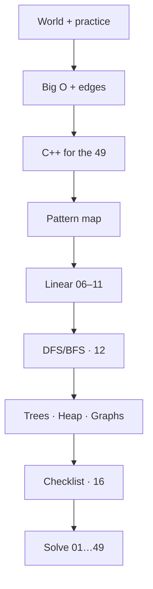

# 📚 Prep Before The 49

Study this folder **before** you solve.  
Concepts are for **everyone**. Code sketches are short **C++** (other languages: learn the idea, then translate).

> ✅ **Ready now** — nothing here waits on you solving.  
> ▶️ **After this pack** → problem folders `01`…`49`.

---

## 🗺️ The path at a glance

```text
  You are here (prep)
       │
       ▼
  00–02   World + how to practice
  03      Big O + edges
  04      C++ enough for the 49
  05      Map of all 49
  06–11   Linear patterns (hash → list)
  12      DFS / BFS engine   ← before trees & graphs
  13–15   Trees · Heap · Graphs
  16      Checklist → start solving
```

> ⚠️ Follow **`Next →`** at the bottom of each sheet.  
> Do **not** jump to Trees / Graphs before sheet **12**.

---

## 🧭 Why this order?

Each sheet only needs what you already learned:

| Stage | You learn | So that… |
|:---|:---|:---|
| **00–02** | What PS / LeetCode are + how to read | You never open a problem blind |
| **03** | Big O + edge cases | You can judge speed and test boundaries |
| **04** | Short C++ / STL | Repo solutions are readable |
| **05** | Bird’s-eye map | You know where each `#` lives |
| **06–11** | Hash → list | Foundations before trees |
| **12** | Recursion, DFS, BFS | Trees & graphs make sense |
| **13–15** | Trees, heap, graphs | Last pattern families |
| **16** | Checklist | You start solving only when ready |

---

## 🗣️ Language policy

| You are… | Do this |
|:---|:---|
| **Any language** | Read the ideas; treat C++ as portable pseudocode |
| **C++ (this repo)** | Finish **04** carefully before deep pattern coding |
| **Everyone** | Keep examples **short** — topics in order, not giant programs |

```text
  Idea   (hash set, two pointers, …)  →  same everywhere
  Syntax (unordered_set, …)           →  shown in C++ here
```

---

## 📂 Study path

File number = learn order.

### Phase A — Enter the world

| # | File | What |
|:---:|:---|:---|
| 0 | [00-Glossary](./00-Glossary.md) | 📖 Vocabulary |
| 1 | [01-Welcome-To-The-World](./01-Welcome-To-The-World.md) | 🌍 PS + LeetCode |
| 2 | [02-How-To-Practice](./02-How-To-Practice.md) | 🧭 Read + playbook |

### Phase B — Speak efficiency + C++

| # | File | What |
|:---:|:---|:---|
| 3 | [03-Big-O-And-Edges](./03-Big-O-And-Edges.md) | ⏱️ Complexity + edges |
| 4 | [04-Cpp-For-The-49](./04-Cpp-For-The-49.md) | 💻 Basics + STL |

### Phase C — Patterns for the 49

| # | File | What |
|:---:|:---|:---|
| 5 | [05-Pattern-Map-For-The-49](./05-Pattern-Map-For-The-49.md) | 🗺️ All 49 → sheet |
| 6 | [06-Arrays-Hashing](./06-Arrays-Hashing.md) | 📦 #1–8 |
| 7 | [07-Two-Pointers](./07-Two-Pointers.md) | 👆 #9–12 |
| 8 | [08-Sliding-Window](./08-Sliding-Window.md) | 🪟 #13–15 |
| 9 | [09-Stack](./09-Stack.md) | 📚 #16–18 |
| 10 | [10-Binary-Search](./10-Binary-Search.md) | 🎯 #19–21 |
| 11 | [11-Linked-List](./11-Linked-List.md) | 🔗 #22–27 |
| 12 | [12-Traversal-Recursion-Queue](./12-Traversal-Recursion-Queue.md) | 🔁 DFS / BFS |
| 13 | [13-Trees-BST](./13-Trees-BST.md) | 🌳 #28–39 |
| 14 | [14-Heap-Priority-Queue](./14-Heap-Priority-Queue.md) | ⛰️ #40–42 |
| 15 | [15-Graphs](./15-Graphs.md) | 🌐 #43–49 |

### Phase D — Go signal

| # | File | What |
|:---:|:---|:---|
| 16 | [16-Ready-For-The-49-Checklist](./16-Ready-For-The-49-Checklist.md) | ✅ Mastery + sources |

> ℹ️ Still **not** a full DSA book or a full C++ degree — only what you need for these 49.

---

## 🖼️ One picture



---

## 🚀 Quick start

| If you are… | Start here |
|:---|:---|
| Absolute beginner | [00 Glossary](./00-Glossary.md) or [01 Welcome](./01-Welcome-To-The-World.md) |
| Coding in C++ | Don’t skip [04](./04-Cpp-For-The-49.md) |
| Using another language | Learn ideas → rewrite snippets in your language |
| Done with prep | Pass [16 Checklist](./16-Ready-For-The-49-Checklist.md) → solve |

---

## 📌 Pack status

**Complete** — sheets `00`–`16` + this README.

After prep, solve **one problem at a time**:

1. **You** write the three `.c++` files  
2. **Cursor AI** adds the three `.flowchart.md` files  

Details: root [`README.md`](../README.md) · [`AGENTS.md`](../AGENTS.md)
