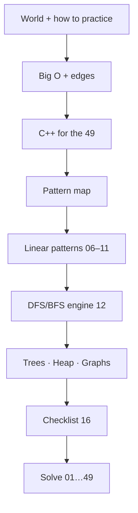

# 00 · Prep Before The 49

> **Complete educational reference** for absolute beginners **and** for C++ solvers in this repo.  
> **Concepts** are for everyone. **Code examples are in C++** (short on purpose) — other languages: learn the idea, then translate.  
> This folder is **ready now**. Solving happens later in `01`…`49`.

```text
  Absolute beginner?
       │
       ▼
  00–02  Glossary · world (PS + LeetCode) · how to practice
       │
       ▼
  03     Big O + edge cases
       │
       ▼
  04     C++ enough for the 49   ← before heavy coding
       │
       ▼
  05     Map of all 49 patterns
       │
       ▼
  06–11  Linear structures (hash → list)
       │
       ▼
  12     DFS / BFS engine          ← before trees & graphs
       │
       ▼
  13–15  Trees · Heap · Graphs
       │
       ▼
  16     Checklist → start problem 01
```

---

## Why this order?

Each sheet assumes only what you already studied:

| Stage | You gain | So that later… |
|:---|:---|:---|
| **00–02** | What the world is + how to read/solve | You never open a problem blind |
| **03** | Big O + edges | You can judge “is this fast enough?” and test boundaries |
| **04** | Short C++ / STL | Pattern sketches and repo solutions are readable |
| **05** | Bird’s-eye map of the 49 | You know *where* each problem lives |
| **06–11** | Hash → pointers → window → stack → search → list | Foundations before trees |
| **12** | Recursion, DFS, BFS | Trees (#28–39) and graphs (#43–49) make sense |
| **13–15** | Trees, heap, graphs | Last pattern families for the 49 |
| **16** | Honest checklist | You only start solving when the gaps are closed |

**Rule:** follow `Next →` at the bottom of each sheet. Do **not** skip to Trees/Graphs before **12**.

---

## Language policy

| Audience | How to use this pack |
|:---|:---|
| **Any language** | Read all concept sections; treat C++ as pseudocode you can port |
| **C++ (this repo)** | Also finish **04** so Brute/Optimal files feel natural |
| **Everyone** | Examples stay **short** — teach topics in order, not giant programs |

```text
  Idea (hash set, two pointers, …)  →  same in every language
  Syntax (unordered_set, …)         →  shown in C++ here
```

---

## Study path (file order = learn order)

| # | File | What |
|:---:|:---|:---|
| **0** | [00-Glossary.md](./00-Glossary.md) | Vocabulary |
| **1** | [01-Welcome-To-The-World.md](./01-Welcome-To-The-World.md) | Problem solving + LeetCode |
| **2** | [02-How-To-Practice.md](./02-How-To-Practice.md) | Read a problem + playbook |
| **3** | [03-Big-O-And-Edges.md](./03-Big-O-And-Edges.md) | Complexity + edge cases |
| **4** | [04-Cpp-For-The-49.md](./04-Cpp-For-The-49.md) | C++ basics + STL (short) |
| **5** | [05-Pattern-Map-For-The-49.md](./05-Pattern-Map-For-The-49.md) | All 49 → pattern |
| **6** | [06-Arrays-Hashing.md](./06-Arrays-Hashing.md) | #1–8 |
| **7** | [07-Two-Pointers.md](./07-Two-Pointers.md) | #9–12 |
| **8** | [08-Sliding-Window.md](./08-Sliding-Window.md) | #13–15 |
| **9** | [09-Stack.md](./09-Stack.md) | #16–18 |
| **10** | [10-Binary-Search.md](./10-Binary-Search.md) | #19–21 |
| **11** | [11-Linked-List.md](./11-Linked-List.md) | #22–27 |
| **12** | [12-Traversal-Recursion-Queue.md](./12-Traversal-Recursion-Queue.md) | DFS / BFS engine |
| **13** | [13-Trees-BST.md](./13-Trees-BST.md) | #28–39 |
| **14** | [14-Heap-Priority-Queue.md](./14-Heap-Priority-Queue.md) | #40–42 (+ #5) |
| **15** | [15-Graphs.md](./15-Graphs.md) | #43–49 |
| **16** | [16-Ready-For-The-49-Checklist.md](./16-Ready-For-The-49-Checklist.md) | Mastery + sources |

Still **not** a full DSA or full C++ degree.

---

## One picture



---

⭐ Absolute beginner: start **[00](./00-Glossary.md)** or **[01](./01-Welcome-To-The-World.md)**.  
⭐ C++ path: don’t skip **[04](./04-Cpp-For-The-49.md)**.  
⭐ Other languages: learn ideas here → rewrite snippets in your language.  
⭐ Ready: pass **[16](./16-Ready-For-The-49-Checklist.md)** — then solve.

---

## Pack status

**Complete** — 17 sheets (`00`–`16` + this README).  
File numbers follow the **learning** order.  

After this pack: solve **one problem at a time** in numbered folders (you → three `.c++` files; Cursor AI → three `.flowchart.md`). See root [`README.md`](../README.md) and [`AGENTS.md`](../AGENTS.md).
