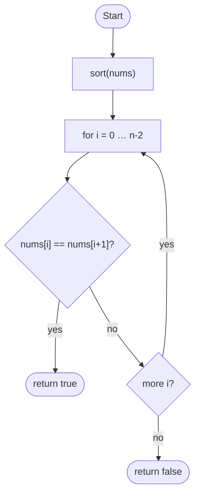

# Optimized · Flowchart — Contains Duplicate

> Mirrors `2-Optimized.c++` · Mermaid (GitHub-rendered) · maintained by Cursor AI

**Time / space (from the C++ comments):** O(n log n) / O(log n) typical sort stack
