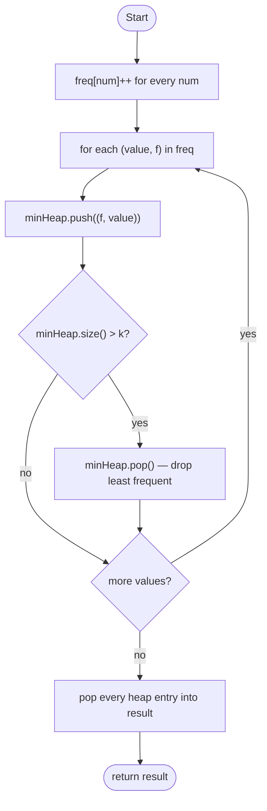

# Optimized · Flowchart — Top K Frequent Elements

> Mirrors `2-Optimized.c++` · Mermaid (GitHub-rendered) · AI-authored reference (`reference-solutions` branch)

**Time / space (from the C++ comments):** O(n + u log k) / O(u + k)
