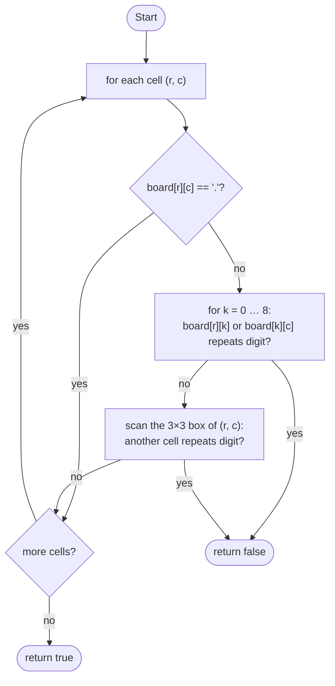

# Brute Force · Flowchart — Valid Sudoku

> Mirrors `1-Brute-Force.c++` · Mermaid (GitHub-rendered) · AI-authored reference (`reference-solutions` branch)

**Time / space (from the C++ comments):** O(n³) for n×n (fixed 9×9) / O(1)
