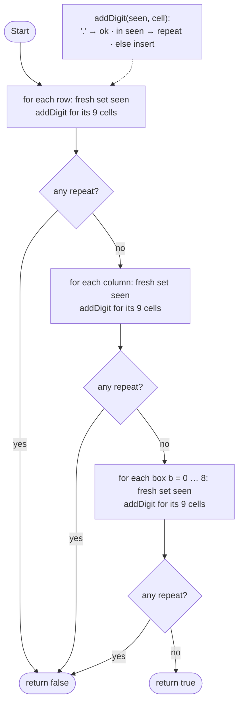

# Optimized · Flowchart — Valid Sudoku

> Mirrors `2-Optimized.c++` · Mermaid (GitHub-rendered) · AI-authored reference (`reference-solutions` branch)

**Time / space (from the C++ comments):** O(n²) for n×n / O(n)
