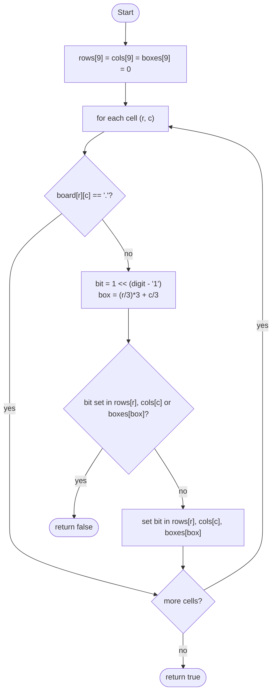

# Optimal · Flowchart — Valid Sudoku

> Mirrors `3-Optimal.c++` · Mermaid (GitHub-rendered) · AI-authored reference (`reference-solutions` branch)

**Time / space (from the C++ comments):** O(n²) for n×n (fixed 81 cells) / O(n)
